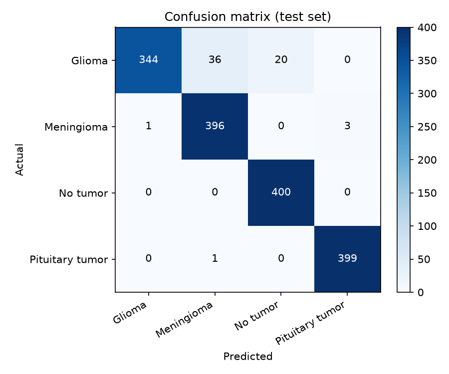
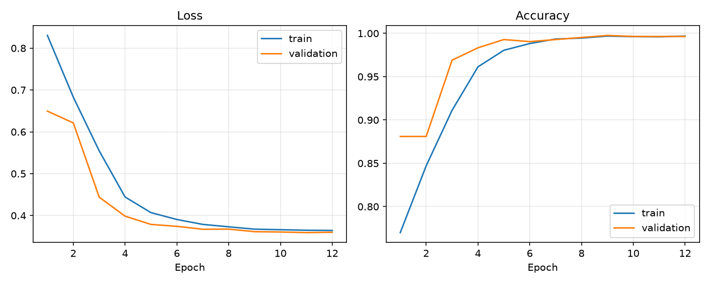

# Brain MRI Tumor Classifier

A deep learning project that classifies brain MRI slices into four classes (**glioma**, **meningioma**, **pituitary tumor** and **no tumor**) and shows *why* it made each prediction with Grad-CAM heatmaps. It covers the full data science workflow: exploratory analysis, transfer learning, honest evaluation on held-out data, model explainability, and an interactive web app.

Built as an applied project following the six-week summer training programme *Applied Deep Learning: From Theory to Real World* (Department of CSE, Central University of Haryana, June–July 2026).

> ⚠️ Educational project only. This is not a medical device and must not be used for diagnosis.

## Results

Evaluated on **1,600 test images** that were never used for training or model selection:

| Metric | Value |
| --- | --- |
| Accuracy | **96.2%** |
| Macro F1 | **0.961** |

| Class | Precision | Recall | F1 |
| --- | --- | --- | --- |
| Glioma | 0.997 | 0.860 | 0.924 |
| Meningioma | 0.915 | 0.990 | 0.951 |
| No tumor | 0.952 | 1.000 | 0.976 |
| Pituitary tumor | 0.993 | 0.998 | 0.995 |



The main weakness is glioma recall: 36 gliomas were predicted as meningioma and 20 as no tumor. When the model says "glioma" it is almost always right (99.7% precision), but it misses some. In a screening setting, missed tumors are the costlier error, so this is the first thing to improve (see [Next steps](#next-steps)).



Validation accuracy reached 99.8%, noticeably higher than the 96.2% test accuracy. The validation set is a random split of the training folder, so it shares the training data's sources and acquisition style, while the test folder in this dataset is harder. This is why the test set, not the validation set, is the number reported above.

## How it works

**1. Exploratory analysis** ([notebooks/01_data_exploration.ipynb](notebooks/01_data_exploration.ipynb)). The 7,200 images are balanced across the four classes, but vary widely in size (150 to 1,446 px) and colour mode (a mix of greyscale and RGB). An MD5 hash check found 187 exact duplicate files within the splits, and none shared between the training and test folders, so the test score is not inflated by leakage.

**2. Preprocessing** ([brainmri/data.py](brainmri/data.py)). Every image is converted to greyscale, replicated to three channels for the ImageNet backbone, resized to 224×224 and normalised. Training images are augmented with random crops, horizontal flips, small rotations and brightness/contrast changes, which imitate the natural variation between MRI scans. 15% of the training folder is held out as a stratified validation set.

**3. Model** ([brainmri/model.py](brainmri/model.py)). EfficientNet-B0 pretrained on ImageNet, with its classifier replaced by dropout and a 4-class linear layer. EfficientNet-B0 has 5.3 M parameters, small enough to fine-tune fully on a 4 GB laptop GPU.

**4. Training** ([brainmri/train.py](brainmri/train.py)). Two phases: 2 epochs training only the new head with the backbone frozen, then 10 epochs fine-tuning the whole network with AdamW, a cosine learning-rate schedule, label smoothing (0.1) and mixed-precision training. The checkpoint with the best validation accuracy is kept. Training took about 15 minutes on an NVIDIA RTX 2050. Because of label smoothing, the model's top confidence usually sits around 90–95% rather than 100%, which makes it less overconfident.

**5. Evaluation** ([brainmri/evaluate.py](brainmri/evaluate.py)). Accuracy, per-class precision/recall/F1 and a confusion matrix on the untouched test set, written to [reports/](reports/).

**6. Explainability** ([brainmri/gradcam.py](brainmri/gradcam.py)). Grad-CAM weights the last convolutional feature maps by their gradients with respect to the predicted class, producing a heatmap of the regions that drove the decision. It is a quick sanity check that the model looks at the tumor and not at image borders or scanner artefacts.

**7. Web app** ([app.py](app.py)). A Streamlit app where you upload a scan, or pick one of the bundled samples, and get the prediction, the class probabilities and the Grad-CAM overlay side by side.

## Run it

Requires Python 3.10–3.12. A trained model is included in `models/`, so you can run the app straight away.

```bash
python -m venv .venv
# Windows: .venv\Scripts\activate     macOS/Linux: source .venv/bin/activate
pip install -r requirements.txt
streamlit run app.py
```

For GPU training with an NVIDIA card, install the CUDA build of PyTorch before the other requirements:

```bash
pip install torch torchvision --index-url https://download.pytorch.org/whl/cu124
```

Classify images from the command line:

```bash
python -m brainmri.predict samples/glioma_Te-gl_7.jpg
```

### Retrain from scratch

Download the [Brain Tumor MRI Dataset](https://www.kaggle.com/datasets/masoudnickparvar/brain-tumor-mri-dataset) and unzip it so the folders are `data/raw/Training/<class>/` and `data/raw/Testing/<class>/`. Then:

```bash
python -m brainmri.train       # about 15 min on an RTX 2050
python -m brainmri.evaluate    # writes reports/
```

## Project structure

```
brainmri/
  config.py      paths, class names, image size
  data.py        transforms, train/validation/test loaders
  model.py       EfficientNet-B0 with a 4-class head
  train.py       two-phase fine-tuning
  evaluate.py    test metrics, confusion matrix, training curves
  gradcam.py     Grad-CAM heatmaps
  predict.py     single-image prediction (CLI and app)
app.py           Streamlit web app
notebooks/       exploratory data analysis
models/          trained weights
reports/         metrics, plots, training log
samples/         8 test-set scans for trying the app
tools/           generator for the EDA notebook
```

## Next steps

- Improve glioma recall: class-weighted loss, or tuning the decision threshold to favour recall for tumor classes.
- Test-time augmentation (averaging predictions over flipped and cropped copies).
- Evaluate on an external dataset from a different hospital to measure real-world generalisation.
- Remove near-duplicate images (perceptual hashing), not just exact copies, before splitting.

## Data

Brain Tumor MRI Dataset by Masoud Nickparvar, [Kaggle](https://www.kaggle.com/datasets/masoudnickparvar/brain-tumor-mri-dataset), licensed under [CC BY 4.0](https://creativecommons.org/licenses/by/4.0/). The dataset itself is not included in this repository, apart from the eight sample images in `samples/`.

## License

Code released under the [MIT License](LICENSE).
